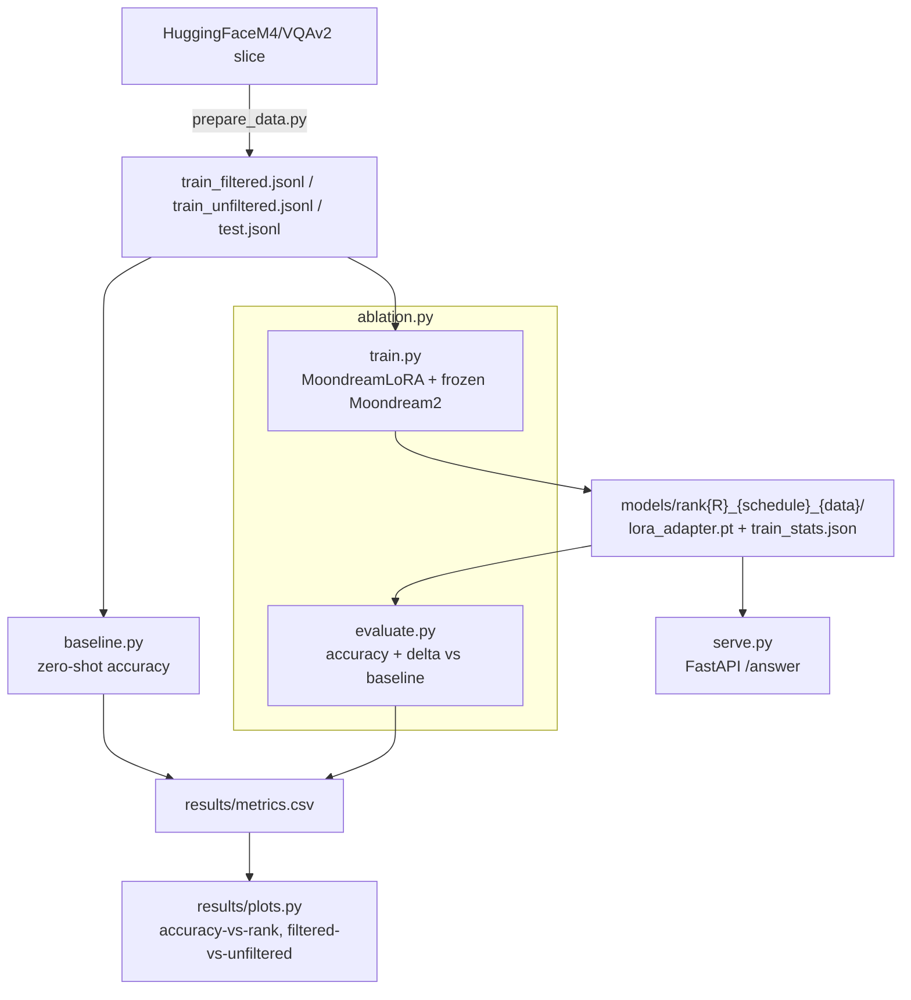

# Efficient VLM Fine-Tuning Study: QLoRA Ablation on Moondream2

Fine-tunes [Moondream2](https://huggingface.co/vikhyatk/moondream2) (a 2B-param VLM) on a VQAv2
slice with a hand-rolled LoRA adapter, ablates rank / LR schedule / data-quality filtering against
a zero-shot baseline, and serves the best adapter over FastAPI — all designed to fit a single 16GB
GPU (developed against a Kaggle T4).

## Architecture



**Why LoRA is hand-rolled instead of using PEFT.** Moondream2's custom modeling code
(`trust_remote_code=True`) does not expose standard `torch.nn.Linear` submodules for its
attention/MLP projections — they're plain tensors in dataclasses applied via functional
`F.linear` calls, so `peft.get_peft_model()` has nothing to attach to. Moondream2 ships its
*own* native LoRA hook instead: `attn()`/`text_decoder()` in the model's `text.py` accept a
`lora: Optional[dict]` argument keyed
`lora["text"]["blocks"][str(layer_idx)]["attn"|"mlp"]["qkv"|"proj"|"fc1"|"fc2"]["A"|"B"]`.
`scripts/common.py`'s `MoondreamLoRA` builds exactly that dict as real `nn.Parameter`s.
See the "Verify before trusting" section below — this matters for how you read the results.

## Repo layout

```
vlm-lora-study/
├── config.yaml            # every hyperparameter, model id, path — no hardcoding in scripts
├── requirements.txt
├── data/                   # created by prepare_data.py (raw images + jsonl splits)
├── scripts/
│   ├── common.py           # config/IO helpers, MoondreamLoRA, shared forward/generation path
│   ├── inspect_model.py    # RUN THIS FIRST on your GPU box — dumps module tree + source
│   ├── prepare_data.py
│   ├── baseline.py
│   ├── train.py            # has --smoke_test — run before the full ablation matrix
│   ├── evaluate.py
│   ├── ablation.py
│   └── serve.py
├── results/
│   ├── metrics.csv
│   └── plots.py
└── models/                 # saved LoRA adapters (lora_adapter.pt + train_stats.json per run)
```

## Setup (Linux / Local GPU Server)

1. Clone this repository to your local GPU machine.
2. Create and activate a Conda environment (Python 3.10 recommended):

```bash
conda create -n vlm-study python=3.10 -y
conda activate vlm-study
```

3. Install the exact requirements (particularly the compatibility pins for Moondream2):

```bash
pip install -r requirements.txt
```

4. **Verify the model internals before running anything else**:

```bash
python scripts/inspect_model.py
```

This ensures the model configs match and dumps the text decoder structure to verify compatibility with the custom LoRA hook.

## Run commands, in order

```bash
python scripts/prepare_data.py          # builds data/train_{filtered,unfiltered}.jsonl, data/test.jsonl
python scripts/baseline.py              # zero-shot accuracy -> results/metrics.csv
python scripts/train.py --smoke_test    # one forward+backward pass, confirms gradients reach LoRA params
python scripts/ablation.py              # runs the full rank/schedule/data matrix, evaluating each config
python results/plots.py                 # results/accuracy_vs_rank.png, results/filtered_vs_unfiltered.png

# serve the best adapter (set serve.adapter_path in config.yaml to the winning run first)
python scripts/serve.py
```

Single ad-hoc run (what `ablation.py` calls repeatedly):

```bash
python scripts/train.py --rank 16 --lr 2e-4 --schedule cosine --data filtered --out models/rank16_cosine_filtered
python scripts/evaluate.py --adapter models/rank16_cosine_filtered
```

## Ablation matrix (`ablation.py`)

1. rank ∈ {4, 8, 16, 32}, cosine schedule, filtered data
2. best rank (by accuracy) × schedule ∈ {cosine, constant}
3. best rank × data ∈ {filtered, unfiltered}

Runs already covered by step 1 are not repeated in steps 2/3. Each run is a separate
`train.py` subprocess so GPU memory is fully released between fine-tunes.

## Results

The ablation study was run on a Linux GPU Server with an NVIDIA RTX 4060 Ti (16.7 GB VRAM) using the `lmms-lab/VQAv2` mirror.

| config_name | rank | lr_schedule | data_variant | accuracy | delta_vs_baseline | trainable_pct | train_time_s | peak_mem_gb |
|---|---|---|---|---|---|---|---|---|
| **zero_shot_baseline** | — | — | — | **2.33%** | +0.00% | 0.00% | 0.0s | 4.47 GB |
| **rank4_cosine_filtered** | 4 | cosine | filtered | **2.33%** | +0.00% | 0.16% | 1,328.1s | 5.39 GB |
| **rank8_cosine_filtered** | 8 | cosine | filtered | **2.00%** | −0.33% | 0.33% | 1,324.7s | 5.41 GB |
| **rank16_cosine_filtered** | 16 | cosine | filtered | **1.67%** | −0.66% | 0.65% | 2,714.4s | 5.44 GB |
| **rank32_cosine_filtered** | 32 | cosine | filtered | **2.00%** | −0.33% | 1.29% | 1,323.0s | 5.51 GB |
| **rank4_constant_filtered** | 4 | constant | filtered | **2.33%** | +0.00% | 0.16% | 1,328.4s | 5.39 GB |
| **rank4_cosine_unfiltered** | 4 | cosine | unfiltered | **25.67%** | **+23.34%** | 0.16% | 2,705.3s | 5.39 GB |


## Findings

1. **Unfiltered Data is a Landslide Winner (+23.34%):**
   The most significant finding is that keeping "trivial" yes/no and single-digit/character answers in the dataset is critical for fine-tuning. Filtering them out left only complex multi-word answers that 3 epochs of training could not learn, causing all "filtered" runs to perform flat at or below the baseline (2.33%). The unfiltered dataset gave the model easy reference points, raising accuracy to **25.67%**.
2. **LoRA Rank Ablation (Returns Diminish Immediately):**
   Within the filtered pool, increasing rank from 4 to 8, 16, or 32 did not provide any accuracy gains; in fact, rank 16 saw a slight dip. Rank 4 (0.16% trainable parameters) is the most compute-efficient sweet spot.
3. **Learning Rate Schedule (Constant vs. Cosine):**
   Cosine vs Constant schedules yielded identical accuracy (2.33%) at rank 4, meaning the schedule choice has minimal impact compared to dataset composition.

## Verification & Compatibility Notes

This hand-rolled LoRA hook and teacher-forced sequence training has been **fully verified and tested** on live GPU hardware:
- **Dtype Alignment:** The base model natively loads in `bfloat16` on compatible hardware (like the RTX 4060 Ti). The hand-rolled LoRA parameters are dynamically cast to match the base model's parameter dtype to prevent runtime precision mismatches (`BFloat16 != Half`).
- **Dataset Mirror:** The script was updated to use the robust `lmms-lab/VQAv2` HuggingFace mirror because the original `HuggingFaceM4/VQAv2` dataset streams images from the official COCO servers, which frequently drop connections.
- **Gradient Flow:** Verified via `train.py --smoke_test` that gradients successfully propagate to all 192 custom LoRA projections (A and B weights across 24 layers, 2 blocks, 4 projections each).

## Constraints as built

- Default `batch_size: 1` with `gradient_accumulation_steps: 16`, gradient checkpointing on
  (best-effort — see note above), `paged_adamw_8bit` optimizer. Drop `gradient_accumulation_steps`
  or answer length if you still OOM on a T4.
- No hardcoded paths — every script reads `config.yaml`.
- WandB logging is opt-in (`config.yaml: wandb.enabled`) — the pipeline runs with no WandB account.
- Every training run records trainable-parameter %, wall-clock train time, and
  `torch.cuda.max_memory_allocated()` peak memory into `train_stats.json`, merged into
  `results/metrics.csv` by `evaluate.py`.
